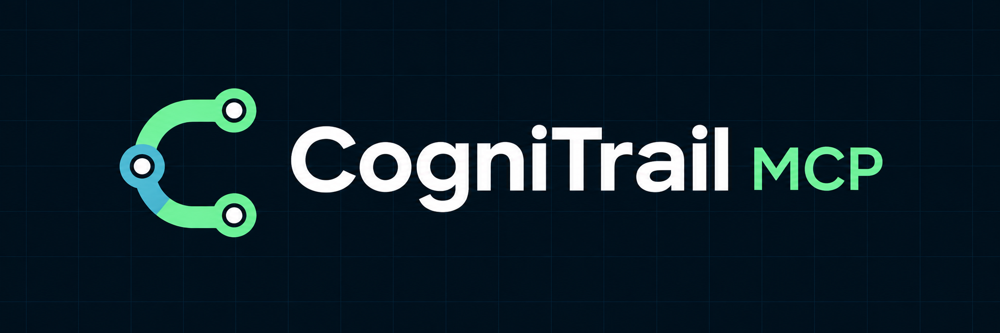
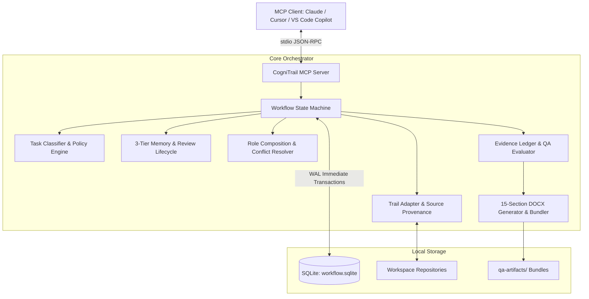

<div align="center">



**Deterministic AI Workflow Orchestrator: Code Graph Indexing, Governed Memory, Multi-Role Personas & Cryptographic Evidence QA**

[](https://www.npmjs.com/package/cognitrail)
[](https://github.com/onenotdev/cognitrail-mcp/blob/main/LICENSE)
[](https://nodejs.org)

[](https://github.com/onenotdev/cognitrail-mcp/stargazers)
[](https://github.com/onenotdev/cognitrail-mcp/forks)
[](https://www.npmjs.com/package/cognitrail)
[](https://www.npmjs.com/package/cognitrail)

<a href="https://buymeacoffee.com/manonebillion" title="Support CogniTrail on Buy Me a Coffee">
  
</a>

Stars and forks track this distribution repository; download counts track the npm package.
GitHub's exact repository view counts are private maintainer analytics and are not exposed by these badges.

[Quick Start](#-quick-start) •
[CLI Commands](#-cli-commands) •
[Architecture](#-architecture) •
[MCP Tools & Resources](#-mcp-tools--resources) •
[10-Role Catalog](#-10-role-engineering-catalog) •
[Client Configuration](#-client-configuration)

</div>

---

## 📌 Overview

**CogniTrail** is a local-first, portable [Model Context Protocol (MCP)](https://modelcontextprotocol.io) server and CLI for autonomous AI coding agents. It prevents AI drift, hallucinations, and skipped development gates through four foundational capabilities:

1. **Trail-Code Graph Indexing**: Ground agent reasoning in verified source spans (`map`, `ask`, `grep`, `skeleton`, `callers`) with SHA-256 source hashing and automatic stale-context invalidation.
2. **Governed Memory Lifecycle**: Three-tier memory (`working`, `episodic`, `semantic`) with formula-driven ranking ($0.35R + 0.25S + 0.20F + 0.10C + 0.10A$), reciprocal conflict surfacing, and independent review approval (`proposer !== reviewer`).
3. **Dynamic Role Composition**: 10 specialized engineering roles with strict authority hierarchy:
   $$\text{Security Policy} > \text{Workspace Rules} > \text{Task Policy} > \text{Primary Role} > \text{Supporting Roles} > \text{Memory}$$
4. **Evidence-Based QA & 15-Section DOCX Generator**: Cryptographically auditable test matrices (API payloads, code lines, database diffs, logs) **without mandatory screenshot attachments**, compiling professional 15-section DOCX report bundles.

---

## 🚀 Quick Start

Set up CogniTrail in any repository with three simple commands:

### 1. Install the CLI globally

```bash
npm install -g cognitrail
```

### 2. Initialize in your project repository

```bash
cognitrail init --yes
```

This automatically:

- Creates the `.cognitrail/` workspace directory.
- Generates a local cryptographic state secret in `.cognitrail/config.json`.
- Initializes and migrates the local SQLite database (`.cognitrail/workflow.sqlite`).
- Wires the MCP server into `.vscode/mcp.json` and `.cursor/mcp.json`.
- Verifies all 10 engineering role packages and checks Trail integration.
- Updates `.gitignore` to keep local SQLite databases and secrets untracked.

### 3. Check workspace status

```bash
cognitrail status
```

Displays database health, active tasks, governed memory entries, loaded roles, and Trail connectivity.

### 4. Restart your AI Agent

Restart your IDE or agent (Visual Studio Code, Cursor, or Claude Desktop) so the session connects to the newly configured CogniTrail MCP server.

---

## 💻 CLI Commands

| Command             | Flags                              | Description                                                                          |
| ------------------- | ---------------------------------- | ------------------------------------------------------------------------------------ |
| `cognitrail init`   | `--yes`, `--dir <path>`, `--force` | Initialize `.cognitrail/`, generate state secret, and wire MCP into agents.          |
| `cognitrail status` | `--dir <path>`, `--json`           | Display workflow database, tasks, governed memory, roles, and Trail status.          |
| `cognitrail serve`  | _(none)_                           | Start the MCP stdio server (default when launched without arguments by MCP clients). |
| `cognitrail --help` | _(none)_                           | Show command usage and options.                                                      |
| `cognitrail -v`     | _(none)_                           | Print installed version number.                                                      |

---

## 🏗 Architecture



See the [Architecture Specification](https://github.com/onenotdev/cognitrail-mcp/blob/main/docs/architecture.md) and [Policy Matrix](https://github.com/onenotdev/cognitrail-mcp/blob/main/docs/policies.md) for complete details.

---

## 🧰 MCP Tools & Resources

### MCP Tools (13 Tools)

| Tool Name              | Category  | Description                                                                             |
| ---------------------- | --------- | --------------------------------------------------------------------------------------- |
| `task_start`           | Lifecycle | Initialize a task, classify risk, select policy, and issue state token.                 |
| `task_status`          | Lifecycle | Read current state, satisfied/missing gates, blockers, and active roles.                |
| `task_advance`         | Lifecycle | Transition task state following policy order and entry gate requirements.               |
| `task_complete`        | Lifecycle | Finalize task after all policy gates and audit evidence are satisfied.                  |
| `task_context`         | Context   | Execute Trail queries and atomically record a grounded context snapshot.                |
| `memory_propose`       | Memory    | Propose a candidate semantic or episodic memory fact with source references.            |
| `memory_review`        | Memory    | Execute review actions (`verify`, `request_review`, `promote`, `reject`, `invalidate`). |
| `catalog_list_roles`   | Roles     | List all 10 available engineering role packages and manifests.                          |
| `task_compose_roles`   | Roles     | Dynamically compose primary and supporting roles with conflict resolution.              |
| `task_get_roles`       | Roles     | Inspect effective instructions, tool policies, and merged checklists.                   |
| `task_record_evidence` | QA        | Record test case steps, expected/actual outcomes, and artifact SHA-256 hashes.          |
| `task_get_evidence`    | QA        | Retrieve evidence ledger summary and test case records for a task.                      |
| `qa_generate_report`   | Reporting | Compile a deterministic 15-section DOCX report and QA artifact bundle.                  |

### MCP Resources (4 Resources)

| Resource URI                  | Description                                                          |
| ----------------------------- | -------------------------------------------------------------------- |
| `roles://catalog`             | Read-only catalog of all available engineering role packages (JSON). |
| `trail://context/{task_id}`   | Read-only JSON snapshot of grounded source code context.             |
| `memory://relevant/{task_id}` | Relevant promoted and fresh memory facts for the active task.        |
| `evidence://ledger/{task_id}` | Complete test case ledger and execution summary for the task.        |

---

## 👥 10-Role Engineering Catalog

Every role contains an explicit manifest, tool permissions, checklist, and evidence schema:

1. **`software-architect`**: Module boundaries, bounded contexts, decoupling, and interface contracts.
2. **`frontend-developer`**: Project-native UI components, form validation, accessibility, and API contract integration.
3. **`backend-developer`**: Service interfaces, safe data access, API contracts, and transactional consistency.
4. **`database-engineer`**: Data modeling, project-native migrations, query-driven indexing, and applicable isolation boundaries.
5. **`qa-tester`**: Requirements traceability, boundary analysis, parity verification, and non-screenshot test ledgers.
6. **`code-reviewer`**: Read-only static analysis, DRY/YAGNI enforcement, type safety, and error recovery audits.
7. **`security-reviewer`**: OWASP Top 10, authorization checks, secret/PII screening, and read-only tool policy.
8. **`migration-specialist`**: Strangler migration, legacy-to-modern parity contracts, and cutover orchestration.
9. **`devops-engineer`**: Build configs, lockfile integrity, dependency management, and process lifecycle.
10. **`tech-writer`**: Technical documentation, architecture decision records, and unambiguous operator guides.

All 10 built-in roles are project- and stack-neutral. Repository documentation, workspace rules, and task requirements supply concrete frameworks, API methods, SQL binding syntax, tenancy models, migration tooling, and validation commands. Project-specific conventions belong in workspace/task context, not the shared role catalog. Role package version 1.1.0 preserves existing role IDs, priorities, tool policies, evidence schemas, and completion gates; previously saved compositions remain historical snapshots and must be recomposed to adopt updated instructions.

Read the [Role Composition Guide](https://github.com/onenotdev/cognitrail-mcp/blob/main/docs/role-composition.md) for detail on conflict resolution rules.

---

## 📑 Evidence-Based QA & 15-Section DOCX Reports

CogniTrail replaces token-heavy visual screenshots with machine-verifiable evidence (`api_response`, `code_reference`, `database_diff`, `console_log`, `exported_file`).

When `qa_generate_report` runs, it emits a complete audit bundle:

```text
qa-artifacts/<task-slug>-<date>/
├── report.docx              # Formal 15-section Microsoft Word document
├── evidence-manifest.json   # Machine-readable list of all evidence items and hashes
├── test-results.json        # Test case execution records and results
├── environment.json         # Git commits, testing environment, and metadata
└── hashes.sha256            # Composite SHA-256 checksums of all bundle files
```

The 15 standardized sections:

1. Halaman Judul
2. Ringkasan Eksekutif
3. Ruang Lingkup dan Tujuan
4. Environment dan Versi yang Diuji
5. Metodologi serta Kriteria Kelulusan
6. Traceability Requirement ke Test Case
7. Ringkasan Hasil
8. Detail Hasil Per Fungsi
9. Parity PHP vs React/Express
10. Temuan, Severity, dan Dampak
11. Bukti Kode (`file:baris`)
12. Bukti API, Data, Console, dan Runtime
13. Risiko, Batasan, serta Item Belum Diuji
14. Rekomendasi dan Keputusan Go/No-Go
15. Lampiran Manifest Evidence dan Hash

Read the [Evidence & QA Strategy Guide](https://github.com/onenotdev/cognitrail-mcp/blob/main/docs/evidence-qa-strategy.md) and [DOCX Reporting Guide](https://github.com/onenotdev/cognitrail-mcp/blob/main/docs/docx-reporting.md).

---

## ⚙ Client Configuration

If `cognitrail init` was run in your repository, `.vscode/mcp.json` and `.cursor/mcp.json` are already configured. For manual setup:

### Claude Desktop

Add to `claude_desktop_config.json`:

```json
{
  "mcpServers": {
    "cognitrail": {
      "command": "npx",
      "args": ["-y", "cognitrail", "serve"],
      "env": {
        "WORKFLOW_STATE_SECRET": "YOUR_RANDOMLY_GENERATED_32_CHAR_SECRET",
        "WORKFLOW_DATABASE_PATH": ".cognitrail/workflow.sqlite",
        "WORKFLOW_WORKSPACE_ROOTS": "."
      }
    }
  }
}
```

### Visual Studio Code (`.vscode/mcp.json`) / Cursor (`.cursor/mcp.json`)

```json
{
  "mcpServers": {
    "cognitrail": {
      "command": "cognitrail",
      "args": ["serve"],
      "env": {
        "WORKFLOW_STATE_SECRET": "YOUR_RANDOMLY_GENERATED_32_CHAR_SECRET",
        "WORKFLOW_DATABASE_PATH": ".cognitrail/workflow.sqlite",
        "WORKFLOW_WORKSPACE_ROOTS": "."
      }
    }
  }
}
```

---

## 📄 License

Proprietary. Copyright (c) 2026 onenotdev. All rights reserved.

Public source visibility does not make CogniTrail open source. Viewing is permitted;
use, copying, modification, redistribution, and commercial exploitation require prior
written permission, subject to applicable law and hosting-platform terms. No rights
to the CogniTrail name or logos are granted. Do not misrepresent the original work's
authorship or imply official endorsement of a derivative product.

See [LICENSE](https://github.com/onenotdev/cognitrail-mcp/blob/main/LICENSE) for the full
terms, including third-party licensing and previously granted rights.

## Protected distribution

The public distribution repository contains packaged runtime files, not the development source or Git history. `npm pack` runs a fresh TypeScript build followed by identifier obfuscation and compaction. Source maps, TypeScript sources, and tests are excluded from the published artifact. Runtime role definitions and SQL migrations remain readable because the application needs them.

This is obfuscation, not encryption or a guarantee against reverse engineering. Published JavaScript can still be inspected or modified. Previously published versions remain readable and are not retroactively protected. Proprietary license terms continue to apply.

Maintainers build and validate from the private development repository; the public distribution is not a source checkout.

## Support and community

If CogniTrail helps your workflow, [star the official repository](https://github.com/onenotdev/cognitrail-mcp) or [buy the maintainer a coffee](https://buymeacoffee.com/manonebillion). Support is optional and does not change the license or grant additional usage rights.

View [CogniTrail on Trendshift](https://trendshift.io/repositories/355694). Daily/monthly award cards will be added only when Trendshift provides an official working badge for this repository.
